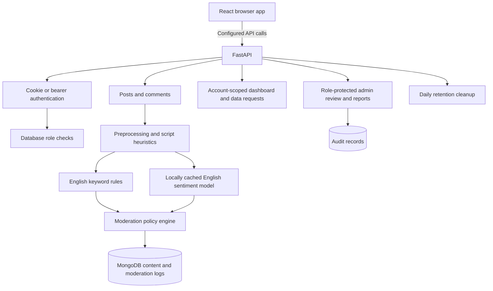

# System Architecture

This is an academic prototype for posting text and reviewing automated moderation predictions. It is not an independently validated hate-speech model, enterprise deployment, or legal/accessibility certification.

## Request flow

1. Authenticated users submit posts or comments to the FastAPI backend.
2. The backend sanitizes and normalizes text, labels a language using script/word-pattern rules, and applies English keyword rules.
3. When locally cached weights are available, the backend runs an English sentiment model and maps its output into the three application labels. Otherwise it uses a heuristic fallback. Model files are local-only by default.
4. Keyword matches can be shown as rule indicators. They are not LIME/SHAP explanations.
5. The moderation engine sets `APPROVED`, `FLAGGED_FOR_REVIEW`, or `BLOCKED`; content and moderation history are stored in MongoDB in production.
6. Users access their own dashboards and account data. Administrators are authorized by a backend role check and can inspect review content, privacy requests, summaries, and audit records.

## Component diagram

## Access and deployment boundary

Admin APIs enforce authorization on the backend. Browser sessions use a signed HttpOnly cookie, SameSite Strict, CORS allow-list and origin checks for cookie-authenticated mutations. Production requires MongoDB and a unique JWT secret. Rate limits are per-process memory controls; HTTPS, database disk/backups, provider access, and hosting logs are deployment responsibilities. See [Privacy Data Map](PRIVACY_DATA_MAP.md) and [Model Documentation](MODEL_DOCUMENTATION.md).
